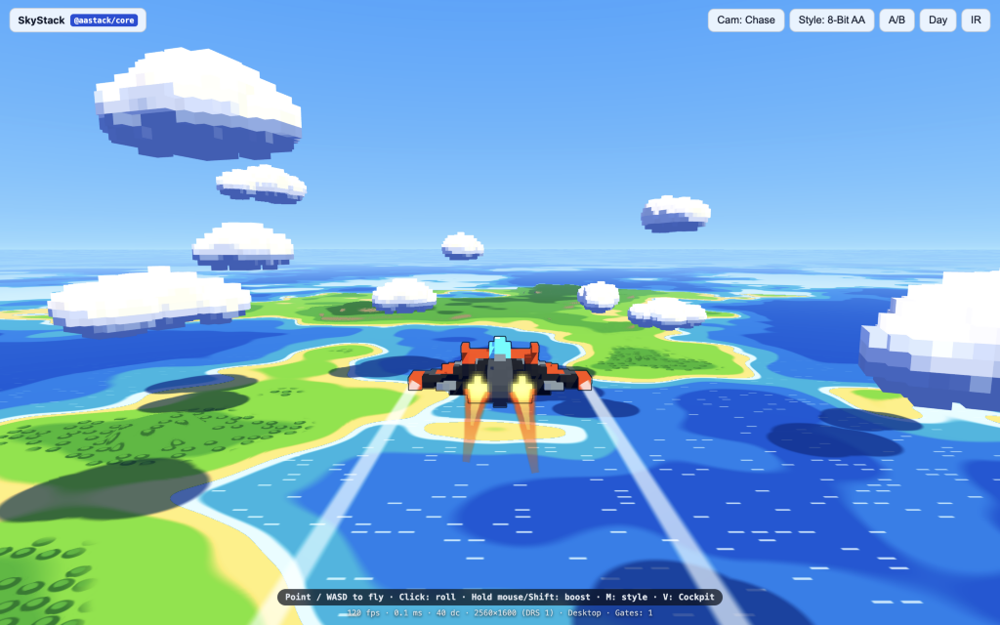
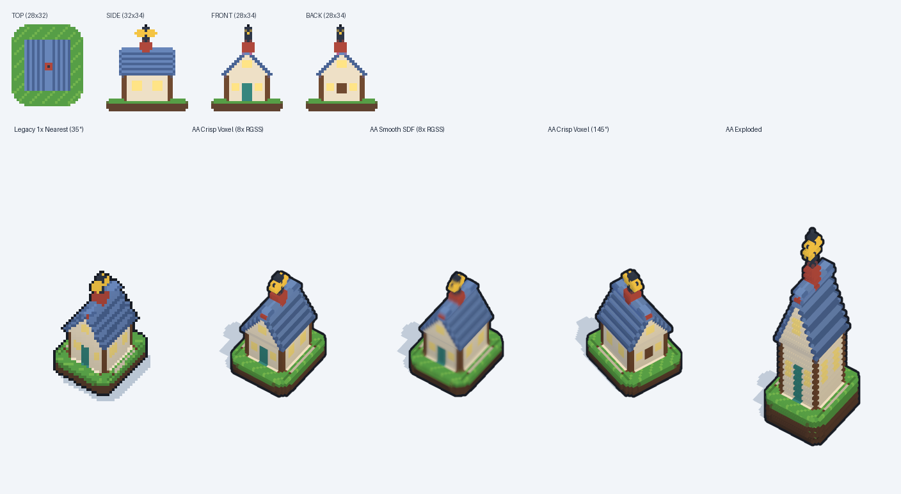
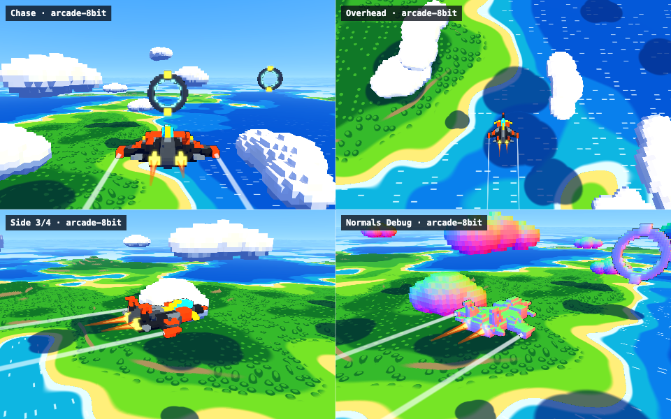

# AASpriteStacker (`@aastack/*`)

> **An AI-first, mobile-friendly, anti-aliased 6-DOF & 2.5D sprite-stacking engine SDK.**  
> Zero polygons. Zero runtime dependencies. ~30.7 KB gzipped full 6-DOF flight demo (`0` dev-bridge bytes when off). Built for game engineers and frontier coding agents.

[](LICENSE)
[](docs/architecture.md)
[](packages/core/package.json)



*Flagship [`SkyStack`](examples/flight-6dof/README.md) 6-DOF flight demo running in default **`arcade-8bit`** mode at `120 fps` (`0.1 ms` CPU frame time, `40` draw calls, `2560×1600` WebGL2): swept-wing fighter jet with fiery dual plumes, 3-tone billowing clouds, indigo cloud shadows, terraced islands with clustered 8-bit trees, and razor-crisp shoreline surf foam — rendered with zero triangle meshes.*

---

## Why AASpriteStacker?

Traditional sprite stacking breaks under rotation and perspective:

| Failure Mode in Classic Sprite Stacking | How AASpriteStacker Solves It |
| --- | --- |
| **Pixel crawl & 1px post dropout** on non-cardinal rotations | **Ray-first 3D Voxel DDA & 3D SDF Sphere Tracing** with `1×/4×/8×` Rotated Grid Supersampling (**RGSS**) |
| **Vertical-wall alpha buildup** (`1 - (1 - α)^N → 1`) & black halos from bilinear filtering | **Linear-light occlusion** + **3D RGB Edge Dilation** (bleeding surface RGB into adjacent transparent neighbors) |
| **Jagged 1px 4-neighbor outlines** that pop during motion | **Object-ID-aware 4-pass 2D Jump Flooding Algorithm (JFA)** SDF outlines in standard `RGBA8` textures (zero float-FBO extensions required) |
| **Breaks completely under 6-DOF pitch, roll, or flying inside clouds** | **12-triangle OBB proxy volumes** with back-face culling and exact `gl_FragDepth` occlusion across terrain, clouds, actors, and 3D contrails |
| **Loss of 8-bit punch & palette vibrance** when smoothing edges | First-class live **`RenderStyle` softswitch**: `"arcade-8bit"` (default), `"hd-2d"`, `"smooth-toy"`, `"retro-raw"` |
| **Hard for LLMs/agents to inspect, edit, or iterate on** | **6 first-principles iterative hooks**: patchable `SceneIR` + undo/redo, deterministic clock + `snapshot`/`restore`, hashed asset hot-swap, semantic sockets, `getStats`/`captureDataUrl`, and 1:1 CPU/GPU spatial queries |



*Left to right: Legacy nearest-neighbor `1×` stack vs. **AA Crisp Voxel DDA (`4×` RGSS)** vs. **AA Smooth 3D SDF (`4×` RGSS)** — reducing 1° temporal rotation shimmer RMS by **50.3%** and **58.0%** respectively.*

---

## Live `RenderStyle` Softswitch

Switch the entire art direction in one atomic patch without rebuilding assets or reloading shaders:

```ts
world.applyPatch([{ op: "set", path: "style", value: "arcade-8bit" }]);
```

| Style | Visual Character | Geometry & Sampling |
| --- | --- | --- |
| **`"arcade-8bit"`** *(default)* | Vibrant 8/16-bit color punch: derivative-width (`fwidth`) crisp ocean/beach/meadow bands, deep royal-indigo cloud shadows, tight hue-shifted cel steps, clustered 8-bit trees, subtle vibrance boost | Crisp Voxel DDA + `4×/8×` RGSS AA + smooth JFA outlines |
| **`"hd-2d"`** | Atmospheric HD-2D look: softer horizon haze, gentler hemisphere & penumbra lighting, broader cel ramp | Crisp Voxel DDA + `4×/8×` RGSS AA + smooth JFA outlines |
| **`"smooth-toy"`** | Sculpted miniature / vinyl-toy aesthetic with curved beveled silhouettes and continuous normals | Continuous 3D SDF Sphere Tracing + `4×/8×` RGSS AA |
| **`"retro-raw"`** | Authentic low-res `1×` nearest-neighbor pixel look — ideal for classic purists or live A/B comparison | `1×` quantized voxel raycast + classic 4-neighbor outlines |

---

## Monorepo Layout

```text
packages/
  core/        # @aastack/core      — Zero-dep WebGL2 6-DOF & 2.5D AA engine, .vox/strip loaders, SceneIR, mobile touch
  blueprint/   # @aastack/blueprint — Declarative JSON/TS Voxel+3D SDF CSG compiler & presets (Jet, Clouds, SkyGate)
  bridge/      # @aastack/bridge    — Isomorphic JSON Schemas, 3D geometric linter, vendor-neutral tool dispatcher & browser dev bridge
  mcp/         # @aastack/mcp       — Stdio MCP server + zero-dep localhost RFC 6455 WS relay for frontier coding agents
examples/
  flight-6dof/ # Flagship "SkyStack" 6-DOF Overhead/Chase/Cockpit flight sandbox (desktop + mobile, ~30.7 KB gz initial load)
skills/
  aa-sprite-stacking/
    SKILL.md                        # Agent skill instructions for 4-view carving & look-dev
    references/engines.md           # Single-draw-call shaders for Godot 4, Unity URP, WebGL2, Canvas 2D
    scripts/aa_views_to_slices.py   # Soft visual-hull + 3D SDF carver + Python RGSS renderer
    scripts/viewer.html             # Zero-install Browser Look-Dev & A/B AA Studio
docs/
  architecture.md                   # Deep dive: math, 3D EDT, 4-pass WebGL2 pipeline, RenderStyle, mobile DRS
  getting-started.md                # Complete developer handbook & all 4 asset pipelines
  api-reference.md                  # Full API docs for @aastack/core, @aastack/blueprint, @aastack/bridge, @aastack/mcp
  flight-demo.md                    # Walkthrough of the SkyStack 6-DOF flight demo & ?bridge=1 co-editing
  ai-integration.md                 # Live MCP bridge, 3D geometric linter, 2×2 visual capture & security boundaries
tests/
  core.test.mjs                     # 6-DOF math, Blueprint CSG, .vox parser, SceneIR, undo/redo, 3D voxel raycast
  bridge.test.mjs                   # JSON Schema validators, vendor adapters, 3D geometric linter, security boundaries
  mcp-bridge.test.mjs               # End-to-end Leader+Follower @aastack/mcp <-> WS Relay <-> Browser Bridge test
  test_aa_stacker.py                # Python AA carving suite (0.00px cardinal wobble, 1px post persistence, shimmer RMS)
```

---

## 60-Second Quick Start

### Prerequisites
- **Node.js `>= 20`** and **npm**
- *(Optional, for Python 4-view image carving CLI & tests)* **Python `>= 3.11`**

### 1. Install, Build & Run All Tests

```bash
git clone https://github.com/dmsimon1/AASpriteStacker.git
cd AASpriteStacker

npm install
npm run build
npm run typecheck
npm test
```

*(Optional)* Set up the Python 4-view carver virtual environment and run the Python test suite:

```bash
python3 -m venv .venv
.venv/bin/pip install -r requirements.txt
npm run test:py
```

### 2. Launch the Flagship Demo & Look-Dev Studio

```bash
npm run dev:serve
```

Open in any WebGL2 desktop or mobile browser:
- **SkyStack 6-DOF Flight Demo:** `http://127.0.0.1:8765/examples/flight-6dof/index.html`
- **4-View Look-Dev & A/B Studio:** `http://127.0.0.1:8765/skills/aa-sprite-stacking/scripts/viewer.html`

### 3. Minimal SDK Example (`@aastack/core` + `@aastack/blueprint`)

```ts
import { AASpriteRenderer, SceneWorld, quatFromYawPitchRoll } from "@aastack/core";
import { compileBlueprint, createFighterJetBlueprint } from "@aastack/blueprint";

const canvas = document.querySelector("canvas")!;
const world = new SceneWorld({ seed: 11 });
const renderer = new AASpriteRenderer(canvas, { quality: "auto", adaptiveDpr: true });

// Compile a declarative CSG blueprint into GPU-ready 3D textures (RGBA + 3D SDF + normals/AO + emissive)
world.registerAsset(compileBlueprint(createFighterJetBlueprint("fighter-jet")));

// Mutate scene state via patchable, undoable SceneIR
world.applyPatch([
  { op: "set", path: "style", value: "arcade-8bit" },
  {
    op: "spawn",
    entity: {
      id: "hero",
      assetId: "fighter-jet",
      pos: [0, 28, 0],
      rot: quatFromYawPitchRoll(0, 0, 0),
      scale: 1.0,
      outline: true,
      castShadow: true,
      tag: "player",
    },
  },
]);

function frame(dt: number) {
  world.stepClock(dt);
  renderer.render(world);
  requestAnimationFrame(() => frame(1 / 60));
}
frame(1 / 60);
```

### 4. Co-Build Live with a Frontier Coding Agent (`@aastack/mcp` + `@aastack/bridge`)

Connect **Antigravity, Claude Code, Cursor, Codex, or Gemini CLI** directly to your running WebGL2 browser canvas for multi-turn visual iteration—no one-shotting required:

```json
{
  "mcpServers": {
    "aastack": {
      "command": "node",
      "args": ["/ABSOLUTE/PATH/TO/AASpriteStacker/packages/mcp/dist/server.js"]
    }
  }
}
```

Open any app wired with `@aastack/bridge/client` using `?bridge=1`:

```text
http://127.0.0.1:8765/examples/flight-6dof/index.html?bridge=1
```

A subtle **"Agent Live"** pill appears with a live status dot, edit toast, and **1-click `Undo`**. Your agent can now hot-swap blueprints live with zero reload (guarded by the 3D floating-voxel & socket linter), patch `SceneIR`, capture **2×2 labeled PNG contact sheets** directly into its vision encoder, and export clean Git-diffable `.blueprint.json` / `.scene.json` files when you like the result.



*(Building a custom LLM app or BYOK UI? `@aastack/bridge/schemas` also exports `toGeminiFunctionDeclarations()`, `toAnthropicTools()`, and `toOpenAITools()` over the exact same `executeEngineTool()` contract.)*

### 5. Bring Your Own Assets (4 Pipelines) or Export Shaders
- **Declarative JSON/TS CSG Blueprints (`@aastack/blueprint`):** `box`, `sphere`, `ellipsoid`, `capsule`, `wedge`, `torus`, `paint`, `subtract`, `mirrorX`, `emissive`, named `sockets`.
- **MagicaVoxel `.vox` (`parseVox`)** & **classic `slices.png` strips (`loadSliceStripPixels`)** — zero-dependency browser loaders.
- **4-View Orthographic PNG Carver CLI:** `.venv/bin/python skills/aa-sprite-stacking/scripts/aa_views_to_slices.py views.png slices.png --slices 36 --sdf sdf.png --preview check.png --html viewer.html`.
- **Godot 4 & Unity URP:** Copy drop-in single-draw-call RGSS DDA & 3D SDF shaders from [`skills/aa-sprite-stacking/references/engines.md`](skills/aa-sprite-stacking/references/engines.md).

---

## Documentation Hub

| Document | What It Covers |
| --- | --- |
| [**Getting Started**](docs/getting-started.md) | Installing workspaces, building your first 6-DOF or 2.5D scene, Blueprint CSG authoring, `.vox` & `slices.png` ingest, 4-view Python carving CLI, mobile touch & `?bridge=1` setup |
| [**Architecture & How It Works**](docs/architecture.md) | First-principles anti-aliasing math, coordinate spaces, `O(N)` 3D EDT, 4-pass WebGL2 pipeline, 16-bit packed JFA outlines, `RenderStyle` shaders, 1:1 CPU/GPU heightfield, mobile DRS |
| [**API Reference**](docs/api-reference.md) | Complete TypeScript API for `@aastack/core`, `@aastack/blueprint`, `@aastack/bridge`, and `@aastack/mcp` |
| [**SkyStack 6-DOF Demo Guide**](docs/flight-demo.md) | Controls, camera rigs, semantic socket attachments, style-aware 16-bit Cockpit HUD, `?bridge=1` co-editing, live `window.__AASTACK__` console scripting, bundle budget |
| [**AI-First Hooks & Live MCP Bridge**](docs/ai-integration.md) | Live localhost WS relay, 18 MCP tools, 3D floating-voxel & socket linter, 2×2 PNG visual capture, security boundaries, and [`llms-full.txt`](llms-full.txt) |
| [**Godot 4 & Unity URP Shaders**](skills/aa-sprite-stacking/references/engines.md) | Drop-in single-draw-call RGSS DDA & 3D SDF shaders for external engines |
| [**Contributing**](CONTRIBUTING.md) | Invariants, dev workflow, testing & visual QA standards, PR checklist |
| [**Roadmap**](ROADMAP.md) | Completed milestones & final release-prep checklist for `v0.1.0` and `v0.2.0+` |

### Package READMEs
- [`packages/core/README.md`](packages/core/README.md)
- [`packages/blueprint/README.md`](packages/blueprint/README.md)
- [`packages/bridge/README.md`](packages/bridge/README.md)
- [`packages/mcp/README.md`](packages/mcp/README.md)
- [`examples/flight-6dof/README.md`](examples/flight-6dof/README.md)

---

## Verified Benchmarks & Footprint

| Metric | Measured Result |
| --- | --- |
| **Desktop 6-DOF Demo (`2560×1600`, `8×` RGSS)** | `120 fps` (`0.1 ms` CPU frame time, `30–40` draw calls, `0` WebGL errors) |
| **Full Demo Initial Load (`examples/flight-6dof`)** | `30.7 KB` gzipped (`0` bytes of dev-bridge/linter loaded unless `?bridge=1` is active; lazy bridge chunk `8.5 KB` gz) |
| **Temporal Rotation Shimmer (1° delta RMS)** | **−50.3%** in AA Voxel DDA (`4.83 → 2.40`), **−58.0%** in AA Smooth SDF (`4.83 → 2.03`) |
| **Cardinal Rotation Drift (`0°/90°/180°/270°`)** | `0.00 px` on even-sized voxel sprites |
| **1px Thin Post Persistence (360° sweep)** | `0` blink/dropout frames in AA modes |

---

## Contributing & Community

Contributions are warmly welcome! Please read:
- [Contributing Guide](CONTRIBUTING.md)
- [Code of Conduct](CODE_OF_CONDUCT.md)
- [Security Policy](SECURITY.md)
- [Changelog](CHANGELOG.md)

## License

Released under the [MIT License](LICENSE).
