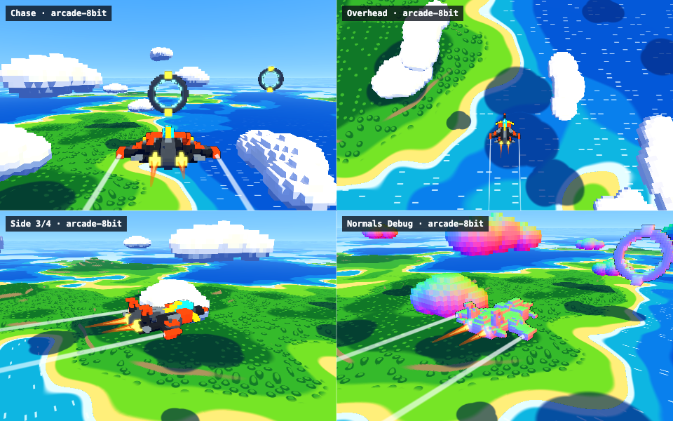
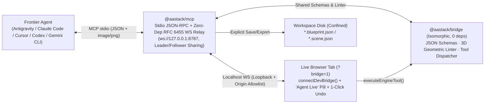

# AI Tooling & Live Agent Bridge (`@aastack/bridge` + `@aastack/mcp`)

**AASpriteStacker** supports AI coding agents out of the box without putting any API keys, model SDKs, or extra runtime dependencies inside `@aastack/core`.

Instead of expecting an agent to one-shot a scene in a single prompt, the engine exposes six iterative hooks plus a zero-dependency localhost WebSocket dev bridge. Any coding agent can inspect state, apply patches, hot-swap blueprints, review 2×2 multi-angle captures, and save Git-diffable JSON across turns.



*A real `960×600` 2×2 diagnostic contact sheet (`Chase`, `Overhead`, `Side 3/4`, `Normals Debug`) returned directly as a native MCP `image/png` content block from live WebGL2 Chromium immediately after an agent hot-swapped golden forward canards onto the fighter jet with zero page reload.*

---

## 1. Architecture: Isomorphic `@aastack/bridge` + Live `@aastack/mcp`



- **Zero production bloat:** `@aastack/core` stays 100% pure. Apps lazy-load `@aastack/bridge/client` only when `?bridge=1` is present (or the dev toggle is clicked), so normal visitors download **0 bytes** of bridge, linter, or schema code.
- **Multi-agent port sharing:** The zero-dependency RFC 6455 WebSocket relay runs inside `@aastack/mcp` on `ws://127.0.0.1:8787` (override via `AASTACK_BRIDGE_PORT`). If a second IDE window or agent starts another `@aastack/mcp` process, it attaches automatically as a **follower peer** to the active leader on the same port without `EADDRINUSE` conflicts.
- **Vendor-neutral schemas:** `@aastack/bridge/schemas` exports Draft 2020-12 JSON Schemas plus one-line adapters (`toOpenAITools()`, `toAnthropicTools()`, `toGeminiFunctionDeclarations()`) so any future in-browser BYOK AI Studio plugs into the exact same `executeEngineTool()` contract.

---

## 2. Connecting Your Coding Agent (`@aastack/mcp`)

Build the monorepo once:

```bash
npm install
npm run build
```

Register `@aastack/mcp` in your MCP client config (Antigravity, Claude Code, Cursor, Codex, Gemini CLI):

```json
{
  "mcpServers": {
    "aastack": {
      "command": "node",
      "args": ["/ABSOLUTE/PATH/TO/AASpriteStacker/packages/mcp/dist/server.js"]
    }
  }
}
```

Then open your app with `?bridge=1`:

```bash
npm run dev:serve
# Open: http://127.0.0.1:8765/examples/flight-6dof/index.html?bridge=1
```

A compact **"Agent Live"** pill appears in the top-left corner showing connection status, a toast of each live agent edit, and a **1-click `Undo`** button backed by `world.undo()`.

---

## 3. Full MCP Tool Surface (18 Tools)

### Live Browser Co-Editing & Visual Self-Critique
| Tool | What It Does |
| --- | --- |
| `aastack_live_sessions` | Lists all connected browser tabs (`sessionId`, title, viewport, FPS, active `RenderStyle`) |
| `aastack_live_state` | Inspects live `SceneDocument`, registered assets, sockets, and WebGL2 `EngineTelemetry` |
| `aastack_live_patch` | Validates & applies atomic `ScenePatchOp[]` with automatic pre-patch undo snapshot and toast label |
| `aastack_live_undo` / `aastack_live_redo` | Steps backward/forward across shared human + agent history |
| `aastack_live_hot_swap_blueprint` | Validates, 3D-lints, compiles, and hot-swaps a `BlueprintSpec` JSON live into the running GPU canvas with zero reload |
| `aastack_live_query` | Exact 1:1 CPU/GPU `terrainHeight`, `raycast`, and semantic `socket` (`pos` + `dir`) queries |
| `aastack_live_capture` | Renders a single PNG (`≤ 1024px`) with optional temporary `style` / `cameraMode` / `debugOverlay`, returned as a native MCP `image/png` block + telemetry JSON (+ optional `savePath`) |
| `aastack_live_capture_views` | Renders a **2×2 labeled PNG contact sheet** (`preset: "turntable"` for `0°/90°/180°/270°` or `preset: "scene"` for `Chase/Overhead/Side 3/4/Normals Debug`), cleanly restoring prior camera & state |
| `aastack_live_snapshot` / `aastack_live_restore` | Deterministic time-travel capture and restore |

### Offline Validation, 3D Linting & Explicit Persistence
| Tool | What It Does |
| --- | --- |
| `aastack_compile_blueprint` | Schema-validates, runs the 3D geometric linter, and compiles a `BlueprintSpec` JSON |
| `aastack_save_blueprint` | Validates, 3D-lints, and writes a clean Git-diffable `.blueprint.json` inside the workspace |
| `aastack_export_scene` | Snapshots the live browser scene (or validates an explicit scene) and writes a clean `.scene.json` inside the workspace |
| `aastack_inspect_vox` | Parses & lints a MagicaVoxel `.vox` binary inside the workspace |
| `aastack_carve_4view` | Runs `aa_views_to_slices.py` on a 4-view orthographic PNG |
| `aastack_validate_scene_ir` | Validates a `SceneDocument` + `ScenePatchOp[]` against strict schemas and mobile entity budgets |
| `aastack_get_sdk_spec` | Loads [`llms-full.txt`](../llms-full.txt) directly into agent context |

---

## 4. Automated 3D Geometric Linter (`@aastack/bridge/linter`)

Every `BlueprintSpec` compilation and live hot-swap automatically runs a `< 1 ms` geometric & mobile-budget check so frontier models self-correct in 1 turn:
- **`EMPTY_VOLUME` (error):** Catches blueprints whose CSG ops produce `0` solid voxels.
- **`FLOATING_VOXEL_ISLAND` (warning):** Exact 3D 6-connected-component BFS reporting the voxel count and `[min..max]` bounding box of every detached floating part.
- **`SOCKET_OUT_OF_BOUNDS` / `SOCKET_DETACHED` (warning):** Flags sockets outside `[0..W, 0..L, 0..H]` or floating `> 4` voxels outside the primary hull's bounding box (while cleanly permitting interior sockets like hollow-ring `"center"` or `"cockpitCam"`).
- **`SPARSE_GRID` / `MOBILE_VRAM_BUDGET` (warning):** Guards mobile 3D texture memory (`> 512 KB`) and entity fill-rate budgets (`> 64` visible OBBs).

---

## 5. Security Boundaries
- The WebSocket relay binds **strictly to `127.0.0.1`** and checks the HTTP `Origin` header against `127.0.0.1` / `localhost` / `null` (rejecting all external websites with `403 Forbidden`), with optional `AASTACK_BRIDGE_TOKEN` authentication.
- All MCP disk reads and writes (`aastack_save_blueprint`, `aastack_export_scene`, `savePath`, `aastack_inspect_vox`, `aastack_carve_4view`) are confined strictly inside the workspace root (`../` path traversal is rejected).
