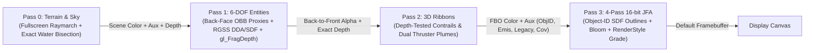

# Architecture & How It Works

This document explains the graphics algorithms, coordinate conventions, volumetric preprocessing, WebGL2 rendering passes, and mobile performance architecture that power **AASpriteStacker** (`@aastack/*`).

---

## 1. Why Classic Sprite Stacking Breaks — And Our Fix

Classic sprite stacking renders $H$ horizontal slices of a voxel model as stacked 2D quads shifted by `(0, -z)` on screen. That approach fails in five well-known ways:

1. **Rotation Pixel Crawl & 1px Post Dropout:** Nearest-neighbor sampling at arbitrary angles causes staircase swimming and makes 1-voxel-thin structures (antennas, masts, wingtips) blink in and out of existence.
2. **Vertical-Wall Alpha Buildup:** Turning on naive bilinear filtering across $H$ stacked slices compounds partial edge alpha: $\alpha_{\text{wall}} = 1 - (1 - \alpha)^H \to 1$, producing bloated, muddy vertical silhouettes.
3. **Black Bilinear Halos:** Standard transparent pixels store `(0, 0, 0, 0)`. Hardware linear/trilinear filtering interpolates toward black at every silhouette edge.
4. **Cardinal-Angle 1-Voxel Drift:** Tiny floating-point epsilon (`sin(π) ≈ 1.22e-16`) causes asymmetric rounding or spurious initial DDA steps at `90°`/`180°` on even-sized sprites.
5. **No True 6-DOF Perspective:** Vertical 2D quad stacks separate into visible gaps ("pancaking") as soon as you pitch or roll the camera, and cannot depth-interleave cleanly with terrain, volumetric clouds, or trails.

**AASpriteStacker** replaces 2D slice quads with **GPU-native 3D volumetric raycasting inside tight 12-triangle Oriented Bounding Box (OBB) proxies**, combined with exact volumetric preprocessing and 2D screen-space SDF post-processing.

---

## 2. Coordinate Systems & Transform Contract

Every package in `@aastack/*` follows one strict right-handed convention:

- **World Space:** Right-handed Y-up: `+X` right, `+Y` up (altitude), `-Z` forward.
- **Voxel Asset Space:** `[0..W, 0..L, 0..H]` stored z-major (`index = z * (W * L) + y * W + x`):
  - `+X`: right (`0 .. W-1`)
  - `+Y`: nose / forward (`0 .. L-1`)
  - `+Z`: up / roof (`0 .. H-1`)
- **Asset-to-Local Mapping (`mat4AssetToLocal` in `packages/core/src/math.ts`):**
  ```text
  localX =  (vx - pivotX) * voxelScale
  localY =  (vz - pivotZ) * voxelScale
  localZ = -(vy - pivotY) * voxelScale
  ```
  Determinant is `+voxelScale³` (strictly orientation-preserving, right-handed).
- **6-DOF Flight Quaternions (`quatFromYawPitchRoll`):** Intrinsic `Y → X → Z` rotation where positive `yaw` turns left (CCW from above), positive `pitch` raises the nose, and positive `roll` banks the right wing down.

---

## 3. Volumetric Preprocessing (`packages/core/src/volume.ts`)

Regardless of how an asset enters the engine (declarative Blueprint CSG, MagicaVoxel `.vox`, `slices.png` strip, or 4-view soft visual-hull carve), `createVolumeAsset()` builds four GPU-ready 3D textures plus a fast content hash:

```text
Input Voxels (RGBA8)
   ├──► 1. O(N) 3-Pass Felzenszwalb–Huttenlocher 3D EDT ──► 3D SDF (float32 + packed R8)
   │        (clamped to exterior air boundary so roof/wall caps always carry outward normals)
   ├──► 2. Central-Difference SDF Gradient + Multi-Offset AO ──► Smooth Normals + AO (RGBA8)
   ├──► 3. 3D RGB Edge Dilation (6-neighbor flood into α=0) ──► Halo-Free Albedo (RGBA8)
   └──► 4. Explicit / Warm-Luma Emissive Mask ──► Emissive 3D Texture (R8)
```

### Key Details
- **Boundary-Safe 3D SDF:** Solid voxels touching the bounding box edge clamp interior distance `dIn` to the exterior air wall distance (`min(x+1, W-x, y+1, L-y, z+1, H-z)`). Without this, roof caps and outer hull panels have flattened `Z` gradients and broken top lighting.
- **3D RGB Edge Dilation:** Transparent voxels (`alpha == 0`) adjacent to solid voxels inherit the nearest solid voxel's RGB while keeping `alpha == 0`. Hardware `GL_LINEAR` trilinear lookups in `smooth-sdf` mode therefore never bleed black fringes.
- **Content-Hashed Hot-Swap:** `VolumeAsset.hash` (FNV-1a over dimensions, voxel data, and sockets) lets `AASpriteRenderer.ensureAssetGPU()` automatically replace GPU 3D textures on the next frame whenever an asset is recompiled or edited — zero manual cache invalidation.

---

## 4. The 4-Pass WebGL2 ES 3.00 Render Pipeline (`packages/core/src/renderer.ts` & `shaders.ts`)

Every frame executes cleanly in 4 deterministic passes using only standard WebGL2 ES 3.00 formats (`RGBA8`, `R8`, `DEPTH_COMPONENT24`) — **zero float-FBO extensions required**, ensuring identical behavior on iOS Safari, Android Chrome, and desktop GPUs:



### Pass 0: Terrain, Ocean, Cloud Shadows & Sky (`TERRAIN_FS`)
- Marches a perspective/orthographic ray through the procedural island archipelago heightfield (`terrainHeight`) using the **sin-free Dave Hoskins 2D hash (`hash21`)**, identical bit-for-bit to CPU `sampleTerrainHeight()`.
- **Zero-Skip Coastline Bisection:** If the ray reaches the ocean plane `Y = 0` (`tWater`) and `terrainHeight(pw.xz) > 0`, it runs a 4-step binary search across `[prevT, tWater]`. This guarantees grazing camera rays never skip over thin coastal beaches.
- **Multi-Lobe Projected Cloud Shadows:** Projects up to 28 shadow-casting entities (clouds and aircraft) onto land and water along `-uSunDir`, using a 3-lobe organic cloud footprint and hue-shifted deep royal-indigo/cool-teal shadows (never muddy gray).
- Writes exact `gl_FragDepth` so flying entities, clouds, and contrails occlude naturally behind cliffs and hills.

### Pass 1: 6-DOF Anti-Aliased Entities (`ENTITY_OBB_VS` / `ENTITY_OBB_FS`)
- Each visible entity draws a single **12-triangle padded unit cube** (`36` indices) transformed by `uVoxelToWorld`.
- **Back-Face Culling (`gl.cullFace(gl.FRONT)`):** Rendering only the OBB's back faces guarantees the fragment shader still executes when the camera flies **inside** a volumetric cloud or right up to an actor!
- **Rotated Grid Supersampling (RGSS):** Traces `1×`, `4×`, or `8×` sub-pixel rays per fragment (`getRgssOffset`), accumulating shaded color in **linear light** (`srgbToLin` → average → `linToSrgb`), outputting true fractional coverage `cov = hits / spp` and closest `gl_FragDepth`.
- **Two Raycast Kernels:**
  - **Amanatides–Woo 3D Voxel DDA (`voxel-dda`):** Exact voxel traversal with epsilon-gated `stepDir` (fixing `0°/90°/180°/270°` cardinal drift to `0.00 px`), optional local 3D self-shadow rays on hero entities, and smart normal blending (`0.24` smooth blend for crisp faceted planes on outlined actors; `0.78` smooth blend for cohesive billowing shading on soft non-outlined clouds).
  - **Continuous 3D SDF Sphere Tracing (`smooth-sdf`):** Raymarches the trilinear-filtered 3D SDF texture with tetrahedral central-difference normals and trilinear halo-free albedo for smooth miniature/toy curves.
- **Distance-Adaptive RGSS LOD:** Hero entities (`tag === "player"` or `dist < 48`) receive full `4×`/`8×` RGSS; mid-range entities drop to `≤ 4×`; far horizon clouds drop to `1×` automatically.
- **MRT Aux Buffer (`outAux`):** Packs `(outlineObjectId, emissiveMask, legacyFlag, coverage)` alongside `outColor` in a single pass.

### Pass 2: Depth-Tested 3D Ribbons (`RIBBON_VS` / `RIBBON_FS`)
- Camera-facing billboard triangle strips generated dynamically from semantic socket histories (`wingtipL`, `wingtipR`, `thrusterL`, `thrusterR`).
- Tested against the Pass 0 + Pass 1 hardware depth buffer (`depthMask(false)`), so contrails and afterburner flames pass cleanly behind clouds, wings, and cliffs. Emissive ribbons write into `outAux.g` to feed Pass 3 bloom automatically.

### Pass 3: 16-Bit Packed `RGBA8` 4-Pass JFA Outlines & Composite (`JFA_INIT_FS`, `JFA_STEP_FS`, `COMPOSITE_FS`)
- **Zero Float-FBO JFA:** Encodes normalized `(u, v)` seed coordinates into two 16-bit integers split across `RGBA8` (`hiX, loX, hiY, loY` — up to `65,535 × 65,535` precision).
- Runs $\lceil \log_2(\text{outlinePx} + 2) \rceil$ ping-pong Jump Flooding passes (`3–4` fullscreen triangles), yielding exact Euclidean distance-to-silhouette at every pixel.
- **Anti-Aliased Outline & Bloom Composite:** Applies a smooth `smoothstep(uOutlinePx - 0.65, uOutlinePx + 0.65, distPx)` silhouette outline only outside outlined objects (`aux.r <= 0.002`), adds a 5×5 Gaussian linear-light emissive bloom around thrusters/canopies/gates, and applies the active `RenderStyle` final grade.

---

## 5. How the Live `RenderStyle` Softswitch Works

`SceneDocument.style` compiles to a single integer uniform (`uStyle`: `0=arcade-8bit`, `1=hd-2d`, `2=smooth-toy`, `3=retro-raw`) shared by `TERRAIN_FS`, `ENTITY_OBB_FS`, and `COMPOSITE_FS`:

- **`0` (`arcade-8bit`):**
  - Terrain uses derivative-width `aaBand(edge, val, minW)` (`smoothstep` over `max(fwidth(val) * 0.85, minW)`) so color steps between cobalt ocean → azure → turquoise shallows → crisp surf foam → golden sand → lime → emerald → pine look **razor-sharp like 8/16-bit pixel art**, yet remain **100% shimmer-free** at sub-pixel borders.
  - Pushes horizon haze out (`fogStart = 115.0`) so midground islands stay electric and saturated.
  - Entities use tight hue-shifted 3-stop cel bands (`bw = 0.06`, cool indigo shadows → warm golden highlights).
  - Composite applies subtle vibrance (`1.16×` saturation) and contrast (`1.06×`).
- **`1` (`hd-2d`):**
  - Broader atmospheric gradients (`fogStart = 45.0`), softer cel bands (`bw = 0.16`), gentler cloud shadow penumbra, and neutral color grade.
- **`2` (`smooth-toy`):**
  - Automatically routes raycasting to continuous 3D SDF sphere tracing (`smooth-sdf`) with curved silhouettes and soft lighting.
- **`3` (`retro-raw`):**
  - Quantizes screen rays to low-res pixel blocks (`1×` sampling), enables hard unblended cel thresholds, and switches outlines to classic 4-neighbor pixel checks — ideal for pure retro aesthetics or side-by-side `A/B` curtain comparisons.

---

## 6. Mobile-First Performance Architecture

Mobile browsers are treated as a primary target, not an afterthought:

1. **Auto Tier Detection (`AASpriteRenderer`):** Detects coarse pointers (`(pointer: coarse)`) or compact viewports (`< 760px`) to select `isMobile`, capping DPR at `1.5×`, RGSS hero samples at `4×`, and terrain ray step multiplier at `1.35×`.
2. **Dynamic Resolution Scaling (DRS) Governor:** Tracks rolling CPU/submit frame time (`rollingMs`). If frame time exceeds `15.5 ms` on mobile, `drsScale` steps gently down (floor `0.68`); when headroom returns below `8.5 ms`, it climbs back to `1.0`.
3. **Power & Tab Conservation:** Demos pair `visibilitychange` with `content-visibility: auto` + `contentvisibilityautostatechange` (with `IntersectionObserver` fallback) so off-screen or backgrounded canvases burn `0%` GPU.
4. **Multi-Touch Ergonomics (`packages/core/src/mobile.ts`):** `createTouchController` tracks independent `pointerId`s so a floating left-hand virtual thumbstick operates concurrently with right-hand `BOOST` / `ROLL` buttons (`≥ 44×44 px` touch targets, `touch-action: none`, `env(safe-area-inset-*)` notch clearance).
