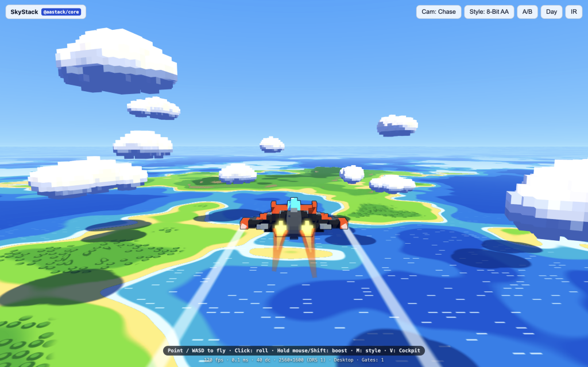

# SkyStack 6-DOF Flight Demo Guide

`examples/flight-6dof/` is a playable 6-DOF flight sandbox built on **AASpriteStacker**. It includes Overhead, Chase, and Cockpit cameras, volumetric clouds, a terraced island archipelago, live render style switching, a 16-bit Cockpit HUD, and mobile multi-touch controls in **`29.8 KB` gzipped** (`94 KB` raw JS) with **zero polygons** and **zero runtime dependencies**.



---

## 1. Running Locally

```bash
npm run build
npm run dev:serve
```

Open: `http://127.0.0.1:8765/examples/flight-6dof/index.html`

---

## 2. Controls & UI

### Desktop Controls
| Input | Action |
| --- | --- |
| **Mouse Pointer** or **`WASD` / Arrow Keys** | Steer yaw/bank & pitch climb/dive |
| **Click** or **`R`** | 360° barrel roll |
| **Hold Mouse** or **`Shift`** | Ignite twin afterburners (`36 → 64 u/s`, fiery extended plumes, FOV punch) |
| **`Space`** or **`V`** (or `Cam` button) | Cycle camera: **Chase → Cockpit → Overhead** |
| **`M`** (or `Style` button) | Cycle live `RenderStyle`: **8-Bit AA → HD-2D → Smooth Toy → Retro 1×** |
| **`C`** (or `A/B` button) | Toggle live draggable **Retro 1× vs. AA** split-screen curtain |
| **`Day` button** | Cycle **Day → Sunset → Night** lighting & bloom |
| **`IR` button** | Open the live **SceneIR Inspector** (`Snapshot`, `Rewind`, `Normals Overlay`, live telemetry JSON) |

### Mobile / Touch Controls (`pointer: coarse` or `< 760px`)
- **Left Half Drag:** Floating virtual thumbstick (`createTouchController`) controls yaw, bank, and climb/dive.
- **Right Action Pad:** `BOOST` (press-and-hold afterburner) and `ROLL` (360° barrel roll), using `66×66 px` touch targets with safe-area notch clearance.
- **Top Bar:** All camera, style, split-screen, and time-of-day buttons expand to `≥ 46 px` touch height automatically.

---

## 3. How the Demo Is Built (`examples/flight-6dof/src/main.ts`)

1. **Zero-Mesh Asset Compilation:** Compiles `FighterJet`, three `Cloud` variants, and hollow `SkyGate` checkpoint rings directly from `@aastack/blueprint` at startup (~25 ms total).
2. **Infinite Volumetric Cloud Field:** Spawns `22` clouds on desktop (`14` on mobile) with `outline: false` and `castShadow: true`, wrapping smoothly around the jet's XZ coordinates so the sky never runs out.
3. **1:1 Terrain Clearance & Radar:** Calls `world.sampleTerrainHeight(x, z)` (the exact CPU twin of `TERRAIN_FS`) to enforce a smooth minimum terrain-clearance floor and paint the rotating `27×27` green CRT island radar in Cockpit mode.
4. **Semantic Socket Attachments:** Every frame reads live world coordinates from `world.getSocketWorldPos("jet", ...)`:
   - `wingtipL` / `wingtipR`: feeds depth-tested 3D white contrail ribbons.
   - `thrusterL` / `thrusterR`: spawns dual-layer emissive afterburner ribbons (outer red-orange flame `[255, 96, 26]` + inner white-gold core `[255, 240, 128]`), lively at cruise and roaring on boost.
   - `cockpitCam`: anchors the true 6-DOF horizon-rolling Cockpit camera directly inside the canopy.
5. **Style-Aware 16-Bit Cockpit HUD (`drawCockpitHud`):**
   - Translucent HUD combiner glass with dynamic heading compass strip (`N/E/S/W`), rolling pitch ladder, speed/alt readouts, and drop-shadowed contrast.
   - Curved beveled metallic canopy arch with racing orange trim.
   - Multi-bevel instrument console with rivets, live rotating green CRT terrain radar (with sweep beam and blue sky-gate blips), **4 analog dials** (`SPD`, `ALT`, `THR`, `BNK`) with moving orange needles, artificial horizon ball, live tilting physical flight yoke/stick, toggle switches + glowing `AB BOOST` indicator, and a right **top-down pixel-art jet status MFD** with dual segmented bar gauges.
   - Automatically compacts cleanly on screens `< 640px`.

---

## 4. Live Scripting & AI Console API (`window.__AASTACK__`)

The demo exposes a live handle on `window.__AASTACK__` for console experimentation, automated visual QA, and external agents:

```js
// Switch rendering style live
__AASTACK__.setStyle("smooth-toy");     // "arcade-8bit" | "hd-2d" | "smooth-toy" | "retro-raw"

// Switch camera mode
__AASTACK__.setCameraMode("cockpit");   // "overhead" | "chase" | "cockpit"

// Lock afterburners on/off
__AASTACK__.setThrust(true);

// Apply any SceneIR patch with full undo support
__AASTACK__.applyPatch([
  { op: "set", path: "lighting.timeOfDay", value: 0.52 },
  { op: "set", path: "debugOverlay", value: "normals" },
]);
__AASTACK__.world.undo();

// Deterministic time-travel & telemetry
const snap = __AASTACK__.world.snapshot();
console.log(__AASTACK__.renderer.getStats());
const pngDataUrl = __AASTACK__.renderer.captureDataUrl(__AASTACK__.world);
```

---

## 5. Live Agent Co-Editing (`?bridge=1`) & Footprint Breakdown

Launch the demo with `?bridge=1` (or click **`Bridge: Off`** inside the `IR` drawer) to lazy-load `@aastack/bridge/client` and attach to your running `@aastack/mcp` relay on `ws://127.0.0.1:8787`:

```text
http://127.0.0.1:8765/examples/flight-6dof/index.html?bridge=1
```

A subtle **"Agent Live"** pill appears below the brand badge with a live status dot, agent edit toast, and a **1-click `Undo`** button.

Built via `scripts/bundle-demos.mjs` (`esbuild --bundle --splitting --minify`):

- **Default Initial Load (`bundle.js` + core chunk):** **`29.8 KB` gzipped** (`0` bytes of bridge/linter/validators downloaded until `?bridge=1` is active)
- **Lazy Dev Bridge Chunk (`dev-bridge-client-*.js`):** `8.7 KB` gzipped (loaded on demand only in `?bridge=1` dev sessions)
- **HTML + CSS (`examples/flight-6dof/index.html`):** `~3.4 KB` gzipped
- **External Runtime Dependencies:** `0`
