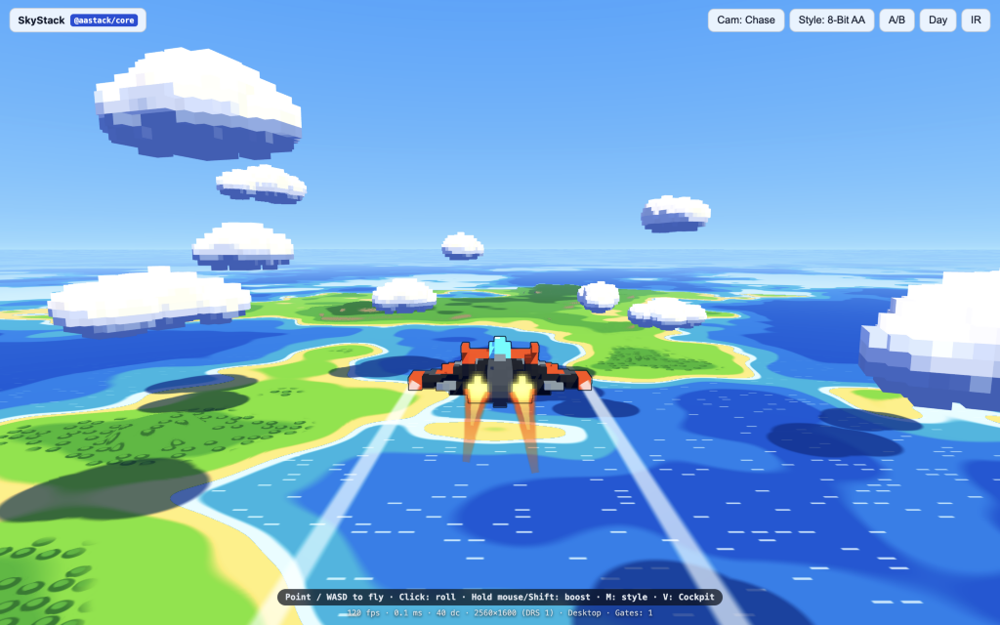

# SkyStack — Flagship 6-DOF Flight Demo

Zero-polygon, anti-aliased 6-DOF flight sandbox powered by `@aastack/core` and `@aastack/blueprint` (`~29.3 KB` gzipped total JS).



## Run Locally

```bash
# From repository root
npm install
npm run build
npm run dev:serve
```

Open `http://127.0.0.1:8765/examples/flight-6dof/index.html`.

## Highlights
- **3 Camera Modes (`V` / `Space`):** Overhead, Chase, and true horizon-rolling 6-DOF Cockpit
- **Live `RenderStyle` Softswitch (`M`):** `8-Bit AA` (default) · `HD-2D` · `Smooth Toy` · `Retro 1×`
- **Live A/B Split-Screen Curtain (`C`):** Drag to compare `Retro 1×` against any AA style in real time
- **Style-Aware 16-Bit Cockpit HUD:** Dynamic compass, rolling pitch ladder, rotating `27×27` green CRT terrain radar, 4 analog dials, tilting control yoke, and pixel-art jet status MFD
- **Mobile Multi-Touch:** Floating left thumbstick + `BOOST` / `ROLL` action pad with safe-area notch support
- **Live Console / AI Handle:** Inspect and patch the running world via `window.__AASTACK__`

Read the full walkthrough in [`docs/flight-demo.md`](../../docs/flight-demo.md).
